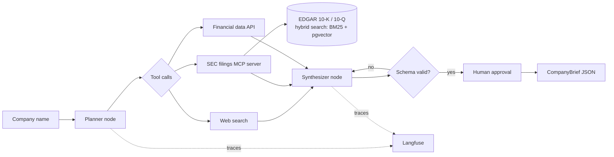

# DealScope Agent

**A LangGraph research agent that turns a company name into a validated, source-cited deal-sourcing brief.**


## The problem

Before a deal team spends time on a company, an analyst assembles a first-pass profile: what the company does,
its size and financial trend, recent news, and red flags. Gathering that from filings, news and data providers
takes hours per company and the output is inconsistent from one analyst to the next.

DealScope automates the first pass. It researches a company through tools, cites every claim, returns a
schema-validated brief that downstream systems can consume, and asks a human to approve before anything is saved.

## Architecture



## Features

| Feature | Status |
|---|---|
| `CompanyBrief` output schema with per-claim source citations | done |
| LangGraph state graph: plan, research, synthesize, validate, approve | in progress |
| SEC EDGAR filings MCP server (fetch, section-aware chunking, hybrid search) | planned |
| Web search and financial data tools | planned |
| Langfuse tracing: cost, latency and tool calls per run | planned |
| Eval suite: task success, tool-call accuracy, citation faithfulness | planned |
| Prompt-injection test cases and PII redaction | planned |
| Response caching and cheap-model-first routing | planned |
| Docker image and Terraform for AWS | planned |

## Tech stack

Python 3.11, LangGraph, Model Context Protocol (MCP), Pydantic, PostgreSQL + pgvector, Langfuse, DeepEval,
Docker, Terraform, GitHub Actions. LLM-agnostic: runs on Gemini or Groq free tiers, or locally with Ollama.

## Project layout

```
agent/         LangGraph graph, nodes, tools and output schemas
mcp_server/    SEC EDGAR filings MCP server
evals/         golden company set and eval runner
infra/         Dockerfile and Terraform
tests/         unit tests
```

## Getting started

```bash
uv sync --extra dev
cp .env.example .env    # add one LLM key and your SEC User-Agent
uv run pytest
```

## Evaluation

Results will be published here once the eval suite runs: task success rate, tool-call accuracy,
citation faithfulness, median latency and cost per brief.

## License

MIT
