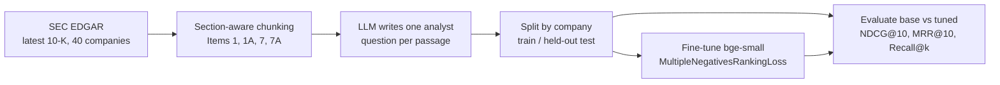

# Domain-tuned embeddings for SEC filings

General-purpose embedding models are trained on web text. 10-K language ("going concern",
"material weakness", "segment margin") is different, and retrieval quality on filings is what
decides whether the agent cites the right passage. This folder builds a retrieval dataset from
real filings, fine-tunes a small embedding model on it, and measures the gain on companies the
model never saw.

| Artifact | Link |
|---|---|
| Dataset | [jc4845/sec-10k-retrieval-qa](https://huggingface.co/datasets/jc4845/sec-10k-retrieval-qa) |
| Model | [jc4845/bge-small-sec-filings](https://huggingface.co/jc4845/bge-small-sec-filings) |

## Pipeline



Design choices:

- **Split by company, not by row.** Random row splits leak company-specific vocabulary into the
  test set and inflate scores.
- **Hard distractors.** Each test query is ranked against every passage from the held-out
  companies, so the model has to tell apart passages from the same filing.
- **No-duplicates batch sampler.** In-batch negatives assume each passage appears once per batch;
  duplicates would be scored as false negatives.

## Results

Held-out test: **355 questions from 6 companies never seen in training** (Chevron, Johnson & Johnson, Meta,
Microsoft, Oracle, Walmart). Each question is ranked against all 355 passages from those companies.
Trained on 1,067 pairs from 18 other companies; 3 epochs on a Kaggle T4 (about 30 seconds of training).

| Metric | Base bge-small | Fine-tuned | Change |
|---|---|---|---|
| Recall@1 | 0.730 | **0.797** | +0.068 |
| MRR@10 | 0.816 | **0.868** | +0.052 |
| NDCG@10 | 0.854 | **0.898** | +0.043 |
| Recall@10 | 0.972 | **0.989** | +0.017 |

The correct passage is now ranked first for 79.7% of questions instead of 73.0%: about a quarter of the
base model's top-1 misses are fixed. Raw numbers: [`results.json`](results.json).

## Run it

```bash
cp .env.example .env    # set SEC_USER_AGENT, GROQ_API_KEY, HF_TOKEN
uv run --extra embeddings python embeddings/build_dataset.py --limit-companies 3   # smoke test
uv run --extra embeddings python embeddings/build_dataset.py --push                # full dataset
```

Fine-tune on a free GPU (Kaggle or Colab, T4):

```bash
pip install "sentence-transformers>=3.3" datasets accelerate
python embeddings/finetune.py --dataset jc4845/sec-10k-retrieval-qa --push
```

On CPU, use `--batch-size 4 --max-seq-length 256 --epochs 1`; it works but is slow.
